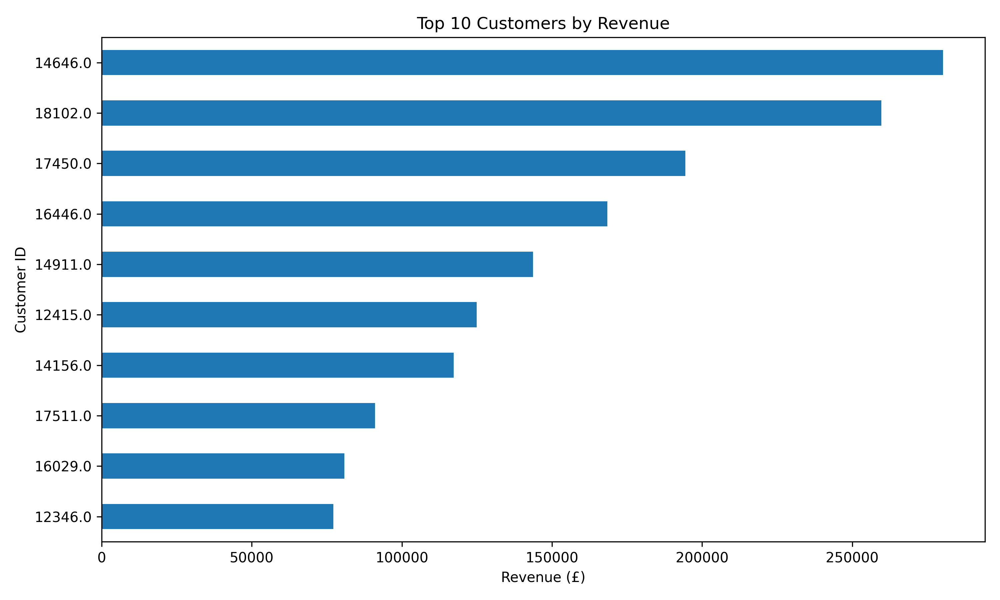
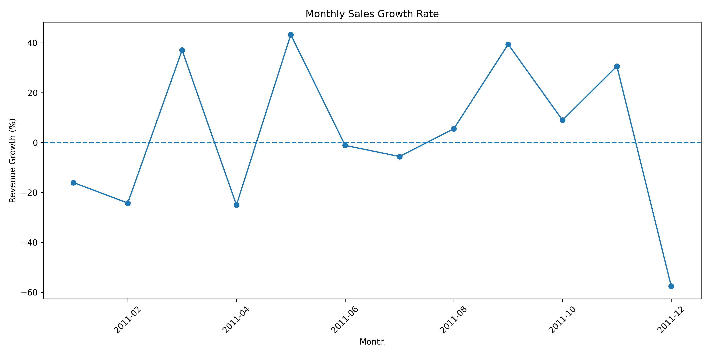

# Retail Sales Analysis 📊

## Project Overview

This project analyzes online retail transaction data using Python to identify sales trends, top-performing products, important markets, and customer purchasing patterns.

## Project Objectives

- Clean and preprocess retail transaction data.
- Analyze monthly revenue trends and growth rates.
- Identify the top 10 products and countries by revenue.
- Compare sales across days of the week.
- Analyze customer spending and repeat purchasing behavior.
- Segment customers using Recency, Frequency, and Monetary (RFM) analysis.
- Communicate findings through data visualizations and business insights.

## Tools and Technologies

- Python
- Pandas
- Matplotlib
- Excel dataset processing
- Git and GitHub

## Visualizations

### Monthly Sales Analysis


### Top 10 Products by Revenue


### Top 10 Countries by Revenue


### Sales by Day of the Week


### Top 10 Customers by Revenue


### Monthly Sales Growth


## Customer Segmentation

Customers are analyzed using RFM metrics:

- **Recency:** Number of days since the customer's latest recorded purchase.
- **Frequency:** Number of distinct invoices associated with the customer.
- **Monetary:** Total recorded revenue generated by the customer.

A rule-based approach assigns customers to segments such as **High Value**, **Regular**, and **Needs Attention**. These labels are based on the implemented thresholds and are not predictions from a trained machine-learning model.

The customer-level results are available in `customer_segmentation.csv`.

## Business Insights

The analysis of the Online Retail dataset revealed the following findings:

- **Total Revenue:** £10,642,110.80
- **Total Units Sold:** 5,572,420
- **Highest-Revenue Month:** November 2011, with £1,503,866.78.
- **Lowest-Revenue Month:** February 2011, with £522,545.56.
- **Top Revenue-Generating Country:** The United Kingdom, with £9,001,744.09, representing approximately 84.59% of total revenue.

### Key Observations

- The United Kingdom generated the majority of recorded revenue in the analyzed dataset.
- November 2011 had the highest recorded monthly revenue.
- Thursday had the highest recorded revenue among the days of the week represented in the cleaned dataset.
- Customer analysis identifies high-revenue customers and customers with multiple recorded invoices.

**Data limitations:** December 2011 contains incomplete monthly data. The dataset also has missing customer IDs for some transactions, so customer-level results exclude transactions without an identifiable customer. These findings describe the available historical data and do not establish future sales performance or customer loyalty.

## Dataset

**Source:** [UCI Machine Learning Repository — Online Retail](https://archive.ics.uci.edu/dataset/352/online+retail)

Download `Online Retail.xlsx` and place it inside the `data` folder.

## How to Run

1. Install Python.
2. Install the required libraries:

   ```bash
   pip install pandas matplotlib openpyxl
   ```

3. Place the dataset at `data/Online Retail.xlsx`.
4. Run the analysis script:

   ```bash
   python retail_analysis.py
   ```

The script generates sales analyses, customer-level results, and visualizations.

## Author

**Imasha Chethani Edirisinghe De Zoysa**
