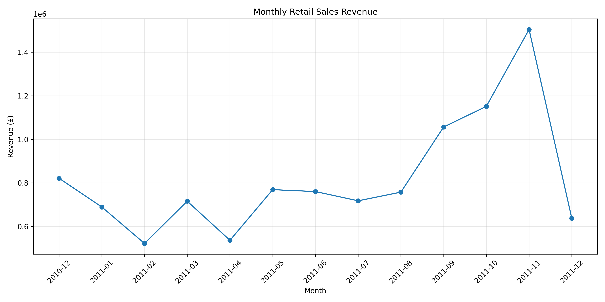
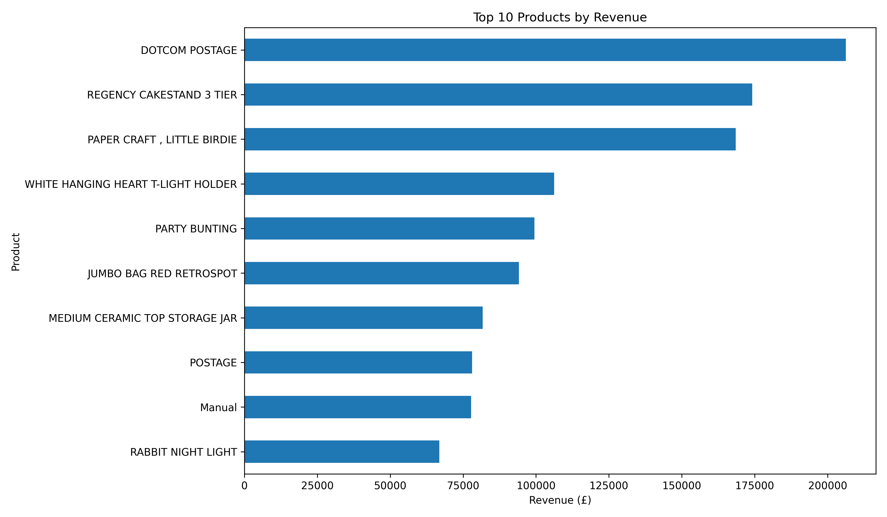
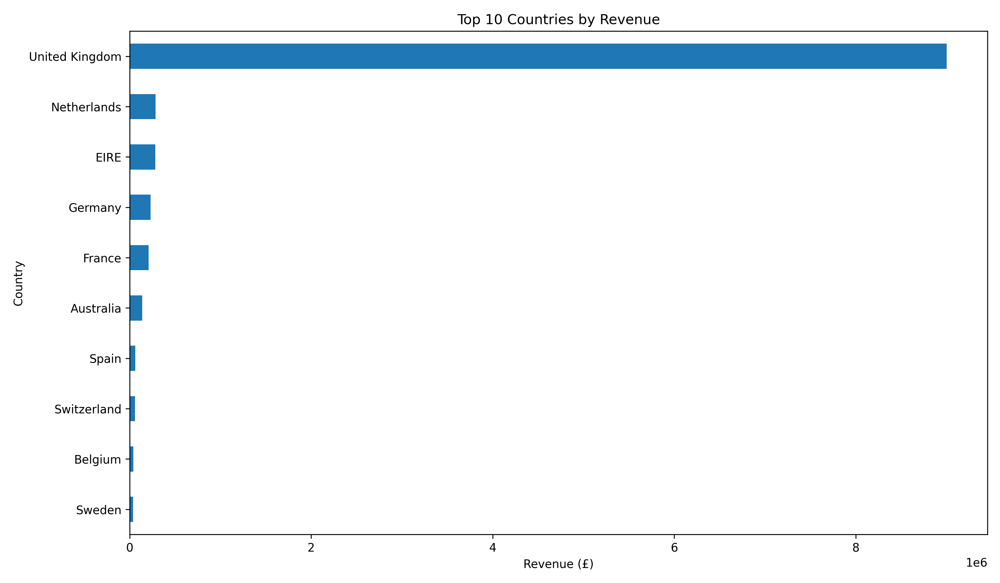
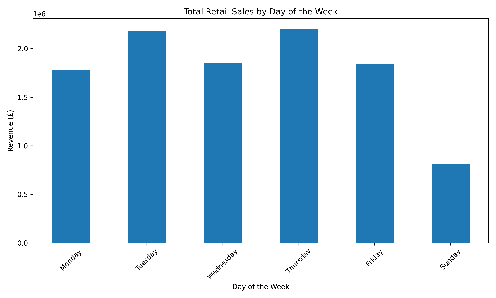

# Retail Sales Analysis 📊

## Project Overview
This project analyzes online retail transaction data using Python to discover sales trends, top-performing products, and countries generating the highest revenue.

## Project Objectives
- Clean and preprocess retail sales data.
- Analyze monthly revenue trends.
- Identify the top 10 products by revenue.
- Identify the top 10 countries by revenue.
- Create charts to communicate insights.

## Tools Used
- Python
- Pandas
- Matplotlib
- Excel

## Visualizations

### Monthly Sales Analysis

### Top 10 Products by Revenue

### Top 10 Countries by Revenue

### Sales by Day of the Week

## Business Insights

The analysis of the Online Retail dataset revealed several important findings:

- **Total Revenue:** £10,642,110.80
- **Total Units Sold:** 5,572,420
- **Best Sales Month:** November 2011, generating £1,503,866.78 in revenue.
- **Lowest Sales Month:** February 2011, generating £522,545.56 in revenue.
- **Top Revenue-Generating Country:** The United Kingdom, contributing £9,001,744.09, or 84.59% of total revenue.

### Key Observation

The United Kingdom was the dominant market in this dataset. November 2011 recorded the highest monthly revenue, while February 2011 recorded the lowest.

**Data Limitation:** December 2011 contains incomplete monthly data, so its revenue should be interpreted with caution.

## Tools and Technologies

- Python
- Pandas
- Matplotlib
- Excel dataset processing
- Git and GitHub

## Dataset
Source: UCI Machine Learning Repository — Online Retail  
https://archive.ics.uci.edu/dataset/352/online+retail

Download `Online Retail.xlsx` and place it inside the `data` folder.

## How to Run
1. Install Python.
2. Install the required libraries:

   `pip install pandas matplotlib openpyxl`

3. Place the dataset in `data/Online Retail.xlsx`.
4. Run:

   `python retail_analysis.py`

## Author
Imasha Chethani Edirisinghe De Zoysa
